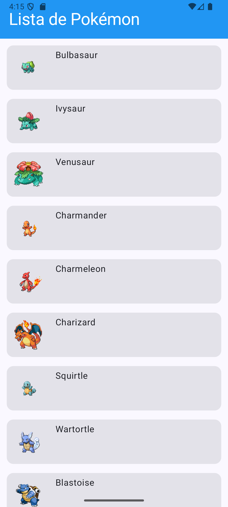
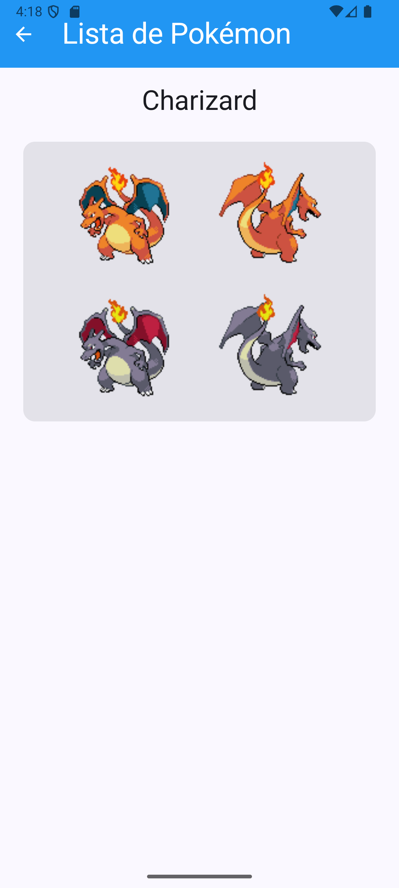

# 🧩 Laboratorio 5 — Network Access with Retrofit (Pokédex App)

## 📱 Descripción del proyecto
Esta aplicación desarrollada en **Kotlin con Jetpack Compose** consume la API pública [PokeAPI](https://pokeapi.co/) para mostrar una lista de los primeros 100 Pokémon.  
Al seleccionar un Pokémon, se navega hacia una segunda pantalla donde se muestran cuatro imágenes del mismo: **frontal, trasera, brillante frontal y brillante trasera**.  

El propósito del laboratorio es aplicar conceptos de **acceso a red con Retrofit**, **manejo de datos JSON**, y **diseño de interfaces modernas** utilizando **Jetpack Compose**.

---

## ⚙️ Tecnologías y librerías utilizadas
- 🟣 **Kotlin**
- 🧱 **Jetpack Compose** — Interfaz moderna declarativa
- 🌐 **Retrofit2** — Cliente HTTP para consumir APIs REST
- 🧩 **Gson Converter** — Serialización y deserialización de JSON
- 🖼️ **Coil** — Carga y renderizado eficiente de imágenes desde URL
- 🧭 **Navigation Compose** — Navegación entre pantallas con parámetros

---

---

## 🧠 Funcionamiento general

### 🏠 Pantalla principal (`PokemonListScreen`)
- Realiza una solicitud HTTP mediante `RetrofitClient` al endpoint: https://pokeapi.co/api/v2/pokemon?limit=100
- Muestra los primeros 100 Pokémon en una lista con su nombre e imagen.
- Incluye un **título con fondo azul** en la parte superior de la pantalla.
- Cada elemento es clicable, permitiendo navegar al detalle del Pokémon seleccionado.


### 🔍 Pantalla de detalle (`PokemonDetailScreen`)
- Recibe el `id` y `nombre` del Pokémon seleccionado.
- Muestra las siguientes imágenes:
- Frontal normal
- Trasera normal
- Frontal brillante
- Trasera brillante  
- Todas las imágenes se obtienen dinámicamente desde los sprites oficiales de la API.

---

## 📸 Capturas de funcionamiento

A continuación se muestran imágenes del funcionamiento de la aplicación:

| Pantalla principal | Detalle del Pokémon |
|--------------------|---------------------|
|  |  |

> 📷 Las capturas se encuentran dentro de la carpeta `screenshots/`.


## 🚀 Ejecución del proyecto

1. Clona el repositorio:
 ```bash
 git clone https://github.com/JuanGualim/Laboratorio-5---Network-access-with-Retrofit.git

